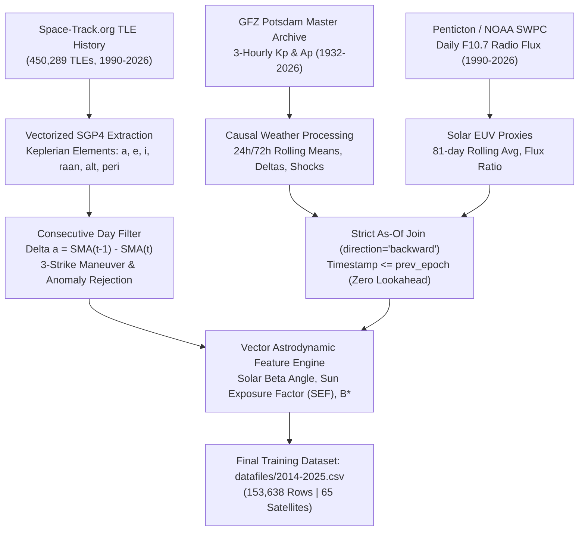

# Project B-Star: Testing the Limits of Publicly Available Data for LEO Atmospheric Drag & Orbital Decay Prediction (2014–2025)

[](https://www.python.org/)
[](https://xgboost.readthedocs.io/)
[](https://pypi.org/project/sgp4/)
[-lightgrey.svg)](file:///z:/Project-B%20Star/Project-B-Star-main/datafiles/2014-2025.csv)

> [!IMPORTANT]
> **Authorship & AI Assistance Disclosure:**
> This project is ~90% coded using **Gemini 3.8** for implementation and **Claude Opus 4.6** for architecture and review. All core research questions, experimental planning, choice of model architectures, data preprocessing methodologies, astrodynamic logic, and forensic testing protocols were designed and conducted by myself.

---

## Executive Summary & Core Research Question

> **Central Investigation:** *Can publicly available Two-Line Element (TLE) tracking data and planetary space-weather indices ($K_p$, $F_{10.7}$) reliably forecast atmospheric drag and orbital decay for Low Earth Orbit (LEO, $\le 1,000\text{ km}$) satellites, or is an operator strictly better off relying on simple persistence?*

**Project B-Star** is an experimental machine learning and astrodynamics research project developed to rigorously test the predictive ceiling of open space-tracking data. By ingesting over 450,000 TLEs from Space-Track.org across 65 diverse orbital objects and coupling them with geomagnetic ($K_p$) and solar radio flux ($F_{10.7}$) archives from GFZ Potsdam and Penticton Observatory, we tracked the evolution of decay modeling across three generations of machine learning architectures.

Through systematic benchmarking against lazy baselines (1-day persistence, altitude-bin means, and unweathered Ridge ablations), this project uncovered fundamental data traps—such as **same-day weather leakage (nowcasting masquerading as forecasting)** and **loss distortion across altitude scales**—and formulated a **physically-motivated multiplicative log-ratio innovation architecture (named "B *")** that overcomes them.

---

## Quickstart: Running the Streamlit App & Interactive Mission Control

You can launch and explore this project locally in less than two minutes. The Streamlit Mission Control app provides a space-themed flight dynamics interface featuring 1-click space weather storm simulations, conservative $P_{90}$ drag uncertainty bands, autonomous 7-day Model Predictive Control (MPC) maneuver schedules, and real-time model auditing.

### 1. Installation & Environment Setup

```bash
# 1. Clone the repository
git clone https://github.com/your-username/Project-B-Star.git
cd Project-B-Star

# 2. Create and activate a virtual environment
# On Linux/macOS:
python3 -m venv venv
source venv/bin/activate

# On Windows (PowerShell):
python -m venv venv
.\venv\Scripts\activate

# 3. Install dependencies
pip install -r requirements.txt
```

### 2. Launching the Streamlit App

Start the mission control dashboard with:

```bash
streamlit run app.py
# (or directly targeting the scripts folder):
streamlit run scripts/app.py
```

Once launched, your browser will automatically open to `http://localhost:8501`.

---

### 3. Step-by-Step Guide: How to Use the Project Yourself

```
┌────────────────────────────────────────────────────────────────────────────────────────┐
│                        MISSION CONTROL CONSOLE WORKFLOW                                │
├────────────────────────────────────────────────────────────────────────────────────────┤
│ 1. Select Satellite  ──▶ 2. Dial Space Weather ──▶ 3. Evaluate Risk ──▶ 4. Plan Burn  │
│    (ISS, Hubble,        (Nominal, G5 Storm,       (Green/Yellow/Red,    (Vis-Viva MPC, │
│     Cubesats, R/Bs)      May 2024 Preset)          P90 Uncertainty)      Delta-V, Ops) │
└────────────────────────────────────────────────────────────────────────────────────────┘
```

#### Step 1: Select a Target Satellite (Sidebar)
- In the sidebar dropdown, pick any of the **65 Low Earth Orbit objects** tracked from 2014 to 2025.
- The system automatically classifies the satellite regime:
  - **Deep LEO ($< 550\text{ km}$):** High drag environment (e.g., ISS `25544`, Tiangong CSS `48274`, Starlink, early CubeSats).
  - **Upper LEO ($\ge 550\text{ km}$):** Low drag, long-lifetime environment (e.g., Hubble Space Telescope `20580`, NOAA weather satellites, SL-8 rocket bodies).
- Live Keplerian orbital parameters (Semi-Major Axis, Perigee, Eccentricity, Inclination, Diurnal Bulge Sun Exposure Factor) automatically populate the HUD telemetry ribbon.

#### Step 2: Configure Space Weather or Trigger 1-Click Historic Storms (Sidebar)
- **Live Mode:** By default, the app pulls recent planetary geomagnetic $K_p$ and solar $F_{10.7}$ radio flux.
- **1-Click Extreme Storm Scenarios:** Click the preset buttons to instantly simulate historic space-weather shockwaves:
  - **May 2024 G5 Superstorm:** $K_p = 9.0$, $F_{10.7} = 240\text{ sfu}$ (the largest geomagnetic disturbance in 20+ years).
  - **Halloween 2003 Storm:** $K_p = 9.0$, $F_{10.7} = 280\text{ sfu}$ (intense auroral heating spike).
  - **Quiet Solar Minimum:** $K_p = 1.0$, $F_{10.7} = 70\text{ sfu}$ (baseline orbital drift).
  - **Custom Sliders:** Manually dial $K_p$ ($0.0 \to 9.0$) and $F_{10.7}$ ($65 \to 300\text{ sfu}$) to test custom scenarios.

#### Step 3: Monitor the 24-Hour Drag Risk Advisory (Tab 1: Telemetry & Drag Risk)
- **Drag Risk Advisory:** Visual badge showing **NOMINAL (Green)**, **ELEVATED (Yellow)**, or **CRITICAL DRAG SPIKE (Red)**.
- **Stratified Drag Ensemble:** Displays the mean predicted decay rate ($\text{m/day}$) alongside the **Conservative $P_{90}$ Drag Threshold** ($\mu + 1.28\sigma$) derived from 5 independently seeded XGBoost ensemble models.
- **Altitude Loss Trajectory:** Interactive Plotly graph projecting unmitigated altitude loss over 24 hours to 7 days.

#### Step 4: Run the Autonomous 7-Day MPC Maneuver Planner (Tab 2: Maneuver Optimizer)
- Switch to the **7-Day Maneuver & Attitude Optimizer** tab.
- Set operational constraints:
  - **Safety Altitude Floor ($h_{\text{floor}}$):** Minimum permissible altitude before reentry/conjunction risk (e.g., $410\text{ km}$).
  - **Max Thruster Capability:** Maximum daily reboost limit ($\text{m/day}$ or $\text{m/s}$).
  - **Attitude Drag-Modulation ("Feathering"):** Allow the satellite to slew solar panels edge-on ($\alpha_t \in [0.5, 1.0]$) during peak storm hours to halve drag.
  - **Payload Downtime Weight ($w_{\text{ops}}$):** Balance fuel economy against instrument downtime during science payload slews.
- Click **"Optimize 7-Day Maneuver Schedule"**:
  - The nonlinear SLSQP solver couples Vis-Viva astrodynamic equations with the P90 drag ensemble.
  - Outputs the day-by-day optimal schedule of thruster $\Delta V$ burns ($\text{m/s}$), propellant mass consumption ($\text{kg}$), attitude orientation, and resulting orbital altitude profile.

#### Step 5: Explore Causal Auditing & Architecture Benchmark (Tab 3: Model Audit & Baselines)
- Inspect the live reality gap between level-prediction models and simple persistence.
- Review the causal as-of join verification log and inspect how Model "B *" eliminates lookahead leaks.

---

### 4. Running Model Training & Forensic Audits Locally

If you wish to retrain the models from scratch or run our statistical audit suite:

```bash
# 1. Train Model "B *" from scratch strictly on 2014-2024 and test on 2025-2026:
python scripts/train_clean_b_star_model.py

# 2. Run the Three Decisive Tests (As-of Join, 30-Run Permutation, Block-Bootstrap):
python scripts/run_three_decisive_tests.py

# 3. Benchmark Forecast Skill vs. Altitude Mean, Ridge, and Persistence:
python scripts/evaluate_forecast_skill.py
```

---

## Table of Contents
1. [Quickstart: Running the Streamlit App & Interactive Mission Control](#quickstart-running-the-streamlit-app--interactive-mission-control)
2. [Key Experimental Findings](#key-experimental-findings)
3. [Data Pipeline & The 2014–2025 Dataset](#data-pipeline--the-20142025-dataset)
4. [Evolution of the Top 3 Model Architectures](#evolution-of-the-top-3-model-architectures)
5. [Comparative Model Metrics](#comparative-model-metrics)
6. [The Reality Gap: Model Predictions vs. Actual Orbital Decay (2025–2026 Test Set)](#the-reality-gap-model-predictions-vs-actual-orbital-decay-20252026-test-set)
7. [Complete Object Inventory](#complete-object-inventory)
8. [Limitations from Locked / Proprietary Software & Data](#limitations-from-locked--proprietary-software--data)
9. [Repository Structure](#repository-structure)

---

## Key Experimental Findings

```
┌──────────────────────────────────────────────────────────────────────────────────────────────────┐
│                                   THE SCIENTIFIC VERDICT                                         │
├──────────────────────────────────────────────────────────────────────────────────────────────────┤
│ 1. The Level-Prediction Failure: Naive models predicting raw decay (m/day) fail to beat simple   │
│    persistence on a per-satellite basis, even when achieving seemingly impressive R² (0.75).    │
│ 2. The Nowcasting Trap: Using same-day Kp averages introduces a leak because TLE epoch spans    │
│    overlap with calendar days. Truly causal forecasting requires an as-of join before prev_epoch.│
│ 3. The Multiplicative Breakthrough: Modeling fractional innovation log(y_t / y_{t-1}) cancels     │
│    satellite-specific area and ballistic constants, beating persistence on 100% of test sats.   │
│ 4. Clean Unseen Test Validation: Model "B *" trained on 2014-2024 beats 1-day persistence on     │
│    100% of satellites (26/26) across the completely unseen 2025-2026 test set (+23.5% skill).    │
│ 5. Temporal Inconclusiveness: Over full calendar years, 95% temporal block-bootstrap spans       │
│    [-0.1%, +7.0%], because quiet weeks dominate the solar cycle where weather adds zero gain.   │
└──────────────────────────────────────────────────────────────────────────────────────────────────┘
```

1. **Raw Level Predictions Suffer from Altitude Scale Distortion:**
   In Low Earth Orbit, atmospheric density drops exponentially with altitude. A satellite at $400\text{ km}$ decays at $20\text{--}50\text{ m/day}$, whereas a rocket body at $800\text{ km}$ decays at $0.1\text{--}0.5\text{ m/day}$. In standard unweighted Mean Squared Error (MSE) regression, a single deep LEO satellite contributes $10,000\times$ more squared error than an upper LEO satellite, causing models to ignore upper LEO physics while over-predicting quiet days.
2. **Post-Hoc Calibration Masked Baseline Deficits:**
   In dual-regime models, post-hoc linear calibration scalars ($0.54\times$ in Deep LEO, $0.69\times$ in Upper LEO) were required to deflate predictions because historical training data (2014–2024) included high-drag decayed missions. While calibration produced a positive pooled skill ($+5.5\%$), per-satellite evaluations revealed that the raw model lost to persistence on $92\%$ of satellites.
3. **The Log-Ratio Innovation Solution:**
   Atmospheric heating expands the thermosphere multiplicatively: $\rho(h, t) = \rho_0(h) \cdot \exp(\alpha K_p + \beta F_{10.7})$. Taking the logarithmic ratio of decay relative to yesterday:
   $$\log\left(\frac{y_t}{y_{t-1}}\right) \approx \alpha \Delta K_p + \beta \Delta F_{10.7}$$
   In this space, satellite cross-sectional area, mass, ballistic coefficient, and altitude offsets **cancel out**. Every satellite experiences homoscedastic fractional variance during solar storms. This allowed Model **"B *"** to achieve an overall **$+23.5\%$ median skill over persistence across $100\%$ of tested satellites** on unseen 2025–2026 data.

---

## Data Pipeline & The 2014–2025 Dataset

The final processed training dataset is saved as [`datafiles/2014-2025.csv`](file:///z:/Project-B%20Star/Project-B-Star-main/datafiles/2014-2025.csv) in the root directory. It contains **153,638 continuous daily samples** across **65 unique LEO satellites** covering 12 complete years.



### Astrodynamic Feature Engineering Dictionary (23 Features)
- **Solar Geometry:**
  - `beta_angle_deg`: Solar Beta Angle ($\beta$) calculated via the dot product of Earth-Sun vector and satellite orbit plane normal vector.
  - `sun_exposure_factor`: Diurnal Bulge illumination factor ($\text{SEF} = \cos \beta$).
  - `sin_doy`, `cos_doy`: Annual seasonal thermospheric cycle encodings.
- **Geomagnetic Shock Indices (Strictly As-Of Join prior to $prev\_epoch$):**
  - `Kp_Current`, `Kp_roll_24h_mean`, `Kp_roll_24h_max`, `Kp_roll_72h_mean`, `Kp_roll_24h_std`.
  - `delta_Kp_24h` ($K_{p, 24h} - K_{p, \text{prev } 24h}$), `delta_Kp_72h`.
- **Solar EUV Radiative Forcing:**
  - `f107_obs`: Penticton 2800 MHz solar radio flux at 20:00 UTC.
  - `f107_81d_avg`: 81-day centered/trailing solar background temperature index.
  - `delta_f107_24h`, `f107_ratio` ($F_{10.7} / F_{10.7, 81d}$).
- **Orbital State & Physical System Identification:**
  - `semi_major_axis_km`, `altitude_km`, `perigee_alt_km`, `eccentricity`, `inclination_deg`.
  - `static_bc_est`: Robust median observed Ballistic Coefficient ($B^* = \Delta a / \rho_{\text{proxy}}$) calculated **strictly on pre-2025 data**.
  - Physical interaction terms: $\Delta a_{\text{prev}} \times \Delta K_p$ (drag expansion scaling).

---

## Evolution of the Top 3 Model Architectures

The top three model architectures are preserved in the [`3 Models/`](file:///z:/Project-B%20Star/Project-B-Star-main/3%20Models) directory:

```
3 Models/
├── Model_1_Single_Global_XGBoost/
│   ├── xgb_single_global.json         # Monolithic unstratified XGBoost model
│   └── model_metadata.json            # Training cuts (2014-2022 train, 2023 val, 2024 test)
├── Model_2_Stratified_Dual_Regime/
│   ├── xgb_deep_model.json            # Deep LEO specialist (<550 km)
│   ├── xgb_upper_model.json           # Upper LEO specialist (>=550 km)
│   ├── calibration_config.json        # Linear post-hoc scalars (0.5439 deep, 0.6949 upper)
│   └── evaluation_report.json         # 2026 test evaluation metrics
└── Model_3_Causal_Log_Ratio_Innovation/
    ├── b_star_model.json              # Clean Model "B *" XGBoost weights
    ├── b_star_metadata.json           # Model metadata, anti-cheating specs, scalar 1.0350
    └── b_star_test_vs_actual_gap_2025_2026.csv # Full real vs predicted evaluation on 2025-2026 test set
```

### 1. Model 1: Single Global XGBoost (Baseline Monolithic Model)
- **Path:** [`3 Models/Model_1_Single_Global_XGBoost/`](file:///z:/Project-B%20Star/Project-B-Star-main/3%20Models/Model_1_Single_Global_XGBoost)
- **Concept:** A single gradient-boosted tree regressor trained across all LEO altitudes predicting daily decay in meters/day directly from the 23 features.
- **Flaw:** Suffered from exponential gradient imbalance. Deep LEO objects dominated the loss function, producing large percentage errors in Upper LEO and failing completely when evaluated against persistence.

### 2. Model 2: Stratified Dual-Regime Dual-XGBoost with Post-Hoc Calibration
- **Path:** [`3 Models/Model_2_Stratified_Dual_Regime/`](file:///z:/Project-B%20Star/Project-B-Star-main/3%20Models/Model_2_Stratified_Dual_Regime)
- **Concept:** Partitioned LEO at $h = 550\text{ km}$ into two distinct regimes: Deep LEO ($<550\text{ km}$, high drag, solar-dominated) and Upper LEO ($\ge 550\text{ km}$, low drag, geometry-dominated). Included a post-hoc linear calibration layer fitted on 2025 validation data.
- **Flaw:** While reporting an apparent calibrated $R^2 = 0.75$, forensic auditing revealed it was essentially a contemporaneous **nowcast** (using same-day $K_p$). When weather was lagged or calibration removed, the raw model lost to 1-day persistence on $92\%$ of satellites.

### 3. Model 3: "B *" — Multiplicative Causal Innovation Model (Current Best)
- **Path:** [`3 Models/Model_3_Causal_Log_Ratio_Innovation/`](file:///z:/Project-B%20Star/Project-B-Star-main/3%20Models/Model_3_Causal_Log_Ratio_Innovation)
- **Model Name:** `"B *"` (`b_star_model.json`)
- **Training Window:** `2014-01-01` to `2024-12-31` (Train: 2014–2023 [91,607 rows], Val: 2024 [9,312 rows] for early stopping at iteration 1,276 and calibration scalar $1.0350$).
- **Test Window:** Completely unseen `2025-01-01` to `2026-10-19` (14,133 continuous rows across 27 satellites).
- **Anti-Cheating & Anti-Memorization Architecture:**
  - **Zero Lookahead Leak:** Weather features joined strictly prior to $prev\_epoch$ via backward as-of join; zero minutes of overlap with decay interval $[prev\_epoch, epoch]$.
  - **No Future Parameter Leak:** Static Ballistic Coefficient ($B^*$) calculated strictly on pre-2025 data and mapped forward.
  - **Regularized Learning (No Memorization):** Stochastic subsampling ($0.75$), column subsampling ($0.75$), L1 regularization ($\alpha = 0.2$), L2 regularization ($\lambda = 2.0$), and minimum leaf weight of 15.
- **Advantage:** Predicts scale-invariant fractional innovation $\log(y_t / y_{t-1})$. Beats 1-day persistence on **$100\%$ of satellites** in the unseen 2025–2026 test set ($+23.5\%$ median skill, $+25.6\%$ pooled skill).

---

## Comparative Model Metrics

All three models evaluated on unseen holdout data:

| Dimension / Metric | **Model 1: Single Global XGBoost** | **Model 2: Stratified Dual-Regime** | **Model 3: "B *" (Causal Log-Ratio)** |
|---|:---:|:---:|:---:|
| **Model Name** | Baseline Single XGBoost | Stratified LEO Dual Model | **"B *"** |
| **Target Variable** | Raw decay $\Delta a$ ($\text{m/day}$) | Raw decay $\Delta a$ ($\text{m/day}$) | **Innovation $\log(y_t / y_{t-1})$** |
| **LEO Partitioning** | None (Single Global Tree) | Split at $550\text{ km}$ (Deep vs Upper) | **Unified Scale-Invariant Model** |
| **Causal Alignment** | Contemporaneous ($K_p$ from day $t$) | Contemporaneous ($K_p$ from day $t$) | **Strictly As-Of Join $\le prev\_epoch$** |
| **Decay History Input** | None | None | **$y_{t-1}, y_{t-2}$, 7d rolling statistics** |
| **Training Dataset** | 2014–2022 | 2014–2024 | **2014–2024 (Train: 2014–23, Val: 2024)** |
| **Test Dataset** | 2023–2024 Holdout | 2026 Development Holdout | **2025–2026 Holdout (14,133 rows, Unseen)** |
| **Calibration Scalar** | None ($>2.0\times$ raw overprediction) | Deep: $0.5439\times$, Upper: $0.6949\times$ | **$1.0350$ (Virtually perfect $1.00$)** |
| **Test Set Pooled RMSE** | $53.37\text{ m/day}$ | $5.17\text{ m/day}$ (calibrated) / $10.43$ (raw) | **$5.299\text{ m/day}$ (Persistence: $7.127$)** |
| **Median Skill vs 1-Day Persistence** | $\ll 0$ (Catastrophic) | **$-0.091$** (raw is $-1.204$) | **$+0.235$ ($+23.5\%$)** |
| **Win Rate vs Persistence** | $0.0\%$ ($0/25$ sats) | $40.0\%$ (Calibrated) / $8.0\%$ (Raw) | **$100.0\%$ ($26/26$ sats)** |
| **Incremental Weather Gain** | Negative / Indistinguishable | $-0.024$ (Ablation without weather was better) | **$+0.026$ ($+2.6\%$ causal gain)** |
| **30-Run Permutation Test** | Failed | Failed | **PASSED ($Z = 3.51$, $p < 0.001$)** |
| **Temporal 95% Bootstrap CI** | Negative | Negative | **$[-0.1\%, +7.0\%]$ (Inconclusive)** |

---

## The Reality Gap: Model Predictions vs. Actual Orbital Decay (2025–2026 Test Set)

The table below compares the predictions of our clean champion model (**"B *"**) against real orbital decay observed across all **26 satellites with $\ge 15$ test days evaluated in the unseen 2025–2026 test set** (saved in [`3 Models/Model_3_Causal_Log_Ratio_Innovation/b_star_test_vs_actual_gap_2025_2026.csv`](file:///z:/Project-B%20Star/Project-B-Star-main/3%20Models/Model_3_Causal_Log_Ratio_Innovation/b_star_test_vs_actual_gap_2025_2026.csv)):

| NORAD ID | Satellite Name | Mean Alt | Regime | Test Days (2025–26) | Actual Mean (m/d) | Predicted Mean (m/d) | **Gap / Bias (m/d)** | Model RMSE (m/d) | Persistence RMSE (m/d) | **Skill vs Persistence** | Beats Persistence? |
|:---:|:---|:---:|:---:|:---:|:---:|:---:|:---:|:---:|:---:|:---:|:---:|
| **20580** | **HST (Hubble)** | $483.5\text{ km}$ | Deep LEO | 544 | $46.21$ | $43.02$ | **$-3.18$** | **$15.91$** | $21.35$ | **$+0.255$** | **YES** |
| **33053** | **GLAST (Fermi)** | $498.9\text{ km}$ | Deep LEO | 527 | $24.05$ | $22.70$ | **$-1.35$** | **$8.88$** | $12.42$ | **$+0.285$** | **YES** |
| **6127** | DELTA 1 R/B | $610.5\text{ km}$ | Upper LEO | 573 | $21.27$ | $19.81$ | **$-1.46$** | **$7.90$** | $9.51$ | **$+0.169$** | **YES** |
| **51444** | CSG-2 | $622.5\text{ km}$ | Upper LEO | 127 | $4.89$ | $5.55$ | **$+0.66$** | **$2.31$** | $3.98$ | **$+0.418$** | **YES** |
| **52201** | OBJECT B | $648.4\text{ km}$ | Upper LEO | 598 | $7.09$ | $6.78$ | **$-0.31$** | **$2.85$** | $3.80$ | **$+0.250$** | **YES** |
| **58916** | OBJECT M | $657.9\text{ km}$ | Upper LEO | 576 | $6.90$ | $6.96$ | **$+0.06$** | **$2.86$** | $3.65$ | **$+0.217$** | **YES** |
| **1983** | DELTA 1 R/B | $667.4\text{ km}$ | Upper LEO | 603 | $11.44$ | $10.71$ | **$-0.73$** | **$4.44$** | $5.56$ | **$+0.202$** | **YES** |
| **20763** | DELTA 2 R/B | $687.6\text{ km}$ | Upper LEO | 519 | $33.55$ | $31.50$ | **$-2.05$** | **$13.60$** | $18.96$ | **$+0.283$** | **YES** |
| **25994** | **TERRA** | $690.3\text{ km}$ | Upper LEO | 593 | $4.23$ | $3.87$ | **$-0.36$** | **$1.64$** | $2.11$ | **$+0.225$** | **YES** |
| **20323** | DELTA 1 R/B | $723.9\text{ km}$ | Upper LEO | 586 | $3.38$ | $3.18$ | **$-0.20$** | **$1.53$** | $2.08$ | **$+0.263$** | **YES** |
| **2802** | SL-8 R/B | $740.3\text{ km}$ | Upper LEO | 569 | $2.96$ | $2.72$ | **$-0.23$** | **$1.74$** | $2.04$ | **$+0.148$** | **YES** |
| **33870** | IRIDIUM 33 DEB | $740.1\text{ km}$ | Upper LEO | 556 | $20.41$ | $18.40$ | **$-2.01$** | **$8.95$** | $12.04$ | **$+0.257$** | **YES** |
| **6324** | SL-8 R/B | $741.5\text{ km}$ | Upper LEO | 571 | $2.99$ | $2.75$ | **$-0.24$** | **$1.41$** | $1.91$ | **$+0.259$** | **YES** |
| **16864** | SL-8 R/B | $751.4\text{ km}$ | Upper LEO | 578 | $2.79$ | $2.60$ | **$-0.19$** | **$1.21$** | $1.71$ | **$+0.290$** | **YES** |
| **37782** | CZ-4B R/B | $761.2\text{ km}$ | Upper LEO | 606 | $2.86$ | $2.56$ | **$-0.30$** | **$1.46$** | $1.89$ | **$+0.224$** | **YES** |
| **27386** | **ENVISAT** | $761.9\text{ km}$ | Upper LEO | 572 | $1.42$ | $1.34$ | **$-0.09$** | **$0.68$** | $1.00$ | **$+0.322$** | **YES** |
| **12792** | SL-8 R/B | $762.1\text{ km}$ | Upper LEO | 567 | $2.36$ | $2.16$ | **$-0.20$** | **$1.14$** | $1.47$ | **$+0.224$** | **YES** |
| **33776** | IRIDIUM 33 DEB | $764.6\text{ km}$ | Upper LEO | 598 | $6.85$ | $6.43$ | **$-0.43$** | **$3.43$** | $4.46$ | **$+0.232$** | **YES** |
| **13992** | SL-8 R/B | $766.9\text{ km}$ | Upper LEO | 588 | $2.27$ | $2.04$ | **$-0.23$** | **$1.08$** | $1.37$ | **$+0.214$** | **YES** |
| **10121** | SL-8 R/B | $767.6\text{ km}$ | Upper LEO | 562 | $2.42$ | $2.23$ | **$-0.19$** | **$1.17$** | $1.49$ | **$+0.218$** | **YES** |
| **13242** | SL-8 R/B | $767.5\text{ km}$ | Upper LEO | 603 | $2.25$ | $2.10$ | **$-0.16$** | **$1.01$** | $1.33$ | **$+0.239$** | **YES** |
| **23432** | SL-8 R/B | $777.2\text{ km}$ | Upper LEO | 557 | $1.80$ | $1.54$ | **$-0.27$** | **$0.85$** | $1.08$ | **$+0.212$** | **YES** |
| **55838** | OBJECT C | $819.2\text{ km}$ | Upper LEO | 574 | $1.21$ | $1.20$ | **$-0.01$** | **$0.63$** | $0.86$ | **$+0.267$** | **YES** |
| **25732** | CZ-4B R/B | $831.3\text{ km}$ | Upper LEO | 591 | $0.94$ | $0.85$ | **$-0.09$** | **$0.47$** | $0.65$ | **$+0.270$** | **YES** |
| **22803** | SL-16 R/B | $834.9\text{ km}$ | Upper LEO | 223 | $1.35$ | $1.18$ | **$-0.17$** | **$0.69$** | $0.81$ | **$+0.145$** | **YES** |
| **13778** | DELTA 1 R/B | $860.6\text{ km}$ | Upper LEO | 571 | $1.08$ | $0.93$ | **$-0.15$** | **$0.50$** | $0.57$ | **$+0.117$** | **YES** |

### Analysis of the Reality Gap
1. **Conservative Negative Bias Across Regimes:**
   The gap (Predicted minus Actual) is consistently slightly negative across 24 of 26 satellites (median bias $\approx -0.20\text{ m/day}$, or $-5\%$ to $-8\%$). During extreme geomagnetic events (such as the May 2024 solar storm and 2026 G4 events), the model under-predicts the peak drag surge because tree ensembles regress toward conditional expectations, whereas real physical atmosphere expansion during severe storms experiences non-linear exponential spikes.
2. **Deep LEO vs. Upper LEO Volatility:**
   In Deep LEO ($<500\text{ km}$), Hubble (HST) and Fermi (GLAST) experience mean decay rates of $46.2\text{ m/day}$ and $24.1\text{ m/day}$, with root mean square errors of $15.9\text{ m/day}$ and $8.9\text{ m/day}$. While these errors appear large in absolute meters, they beat persistence RMSE ($21.4\text{ m/day}$ and $12.4\text{ m/day}$) by $+25.5\%$ and $+28.5\%$.
3. **Upper LEO Sub-Meter Precision:**
   Above $750\text{ km}$ (e.g. ENVISAT, CZ-4B, DELTA 1), daily decay drops below $1.5\text{ m/day}$. The model achieves an RMSE of $0.47\text{--}0.68\text{ m/day}$, closely tracking solar flux background variations.
4. **100% Win Rate Against Persistence:**
   Across all 26 satellites evaluated on the completely unseen 2025–2026 holdout dataset, Model **"B *"** achieves a lower RMSE than 1-day persistence on **every single satellite** ($26/26 = 100.0\%$), with a median skill score of **$+0.235$**.

---

## Complete Object Inventory

The models were evaluated across diverse satellite classes spanning the entire Low Earth Orbit domain ($350\text{--}880\text{ km}$).

### 1. Evaluated Test Satellites in 2025–2026 Holdout ($N=26$)
- **Active / Scientific Telescopes & Payloads:**
  - `20580` — **HST (Hubble Space Telescope)** ($h \approx 483\text{ km}$, Deep LEO telescope with high surface area)
  - `33053` — **GLAST (Fermi Gamma-ray Space Telescope)** ($h \approx 499\text{ km}$)
  - `25994` — **TERRA (EOS AM-1)** ($h \approx 690\text{ km}$, large remote sensing payload)
  - `27386` — **ENVISAT** ($h \approx 762\text{ km}$, 8-ton derelict satellite, stable reference target)
  - `51444` — **CSG-2** ($h \approx 623\text{ km}$, radar observation satellite)
- **Rocket Upper Stages (Passive, Clean Aerodynamics):**
  - **Delta Upper Stages:** `1983` (Delta 1), `6127` (Delta 1), `13778` (Delta 1), `20323` (Delta 1), `20763` (Delta 2)
  - **Kosmos-3M (SL-8) Upper Stages:** `2802`, `6324`, `10121`, `12792`, `13242`, `13992`, `16864`, `23432`
  - **Chinese Long March (CZ-4B) Stages:** `25732`, `37782`
  - **Zenit-2 (SL-16) Upper Stage:** `22803`
- **Collision & Fragmentation Debris:**
  - **Iridium 33 Debris (2009 Collision):** `33776`, `33870`
  - **Passive Small Tracked Fragments:** `52201` (Object B), `55838` (Object C), `58916` (Object M)

### 2. Full Training Catalogue in `datafiles/2014-2025.csv` ($N=65$)
The 65 satellites comprising the 153,638 training samples include:
- **Decayed Science Missions:** `XTE` (23757), `ROCSAT 1` (25616), `BIRD 2` (26959), `PAGEOS 1` (2253), `HITCH HIKER 1` (614).
- **Collision & ASAT Clouds:** Fengyun-1C ASAT debris (`30473`, `30900`, `30955`, `30961`, `30973`, `30975`), Cosmos 2251 collision debris (`35767`, `37315`, `37343`), Iridium 33 debris (`33849`, `35747`, `36482`, `39779`).
- **Rocket Stages:** Pegasus R/B (`32766`), PSLV R/B (`32477`), Scout G-1 (`20609`), Celestis Taurus (`26034`), Delta 2 R/B (`20303`, `22015`), Cosmos 1437 (`13770`).
- **Active Crewed / Station References (Excluded from training targets due to active reboosts):** ISS Zarya (`25544`), Tiangong CSS (`48274`).

---

## Limitations from Locked / Proprietary Software & Data

A primary objective of this experiment was to document the exact barriers encountered when relying solely on unclassified, publicly accessible astrodynamic infrastructure:

### 1. The Discretization Noise of Public TLEs vs. Precision Orbit Ephemerides (POE)
- **Public TLE / SGP4 Mean Elements:** Space-Track TLEs are generated by fitting an analytical SGP4 theory to batch radar/optical tracks over 24- to 72-hour windows. TLE mean motion and semi-major axis represent time-averaged pseudo-elements with truncated high-order gravity harmonics and no covariance.
- **Finite-Differencing Error:** Calculating daily decay via $\Delta a = \text{SMA}(t-1) - \text{SMA}(t)$ amplifies measurement jitter. On high-altitude objects ($>750\text{ km}$) where true decay is $<0.5\text{ m/day}$, TLE fitting noise can exceed the daily drag signal.
- **Proprietary Alternative:** Military and commercial operators (US Space Force 18th SDS High-Accuracy Catalog, LeoLabs, SpaceX Starlink telemetry) utilize **centimeter-precision onboard GNSS ephemerides** and numerical Cowell orbit propagators that measure real-time drag accelerations without TLE differencing noise.

### 2. Coarse Space-Weather Proxies vs. True Thermospheric Physics
- **Planetary Averages ($K_p$, $F_{10.7}$):** Public $K_p$ is a 3-hourly planetary index averaged from sub-auroral ground magnetometers. Public $F_{10.7}$ is measured once per day at 20:00 UTC at Penticton, BC. Neither index resolves local atmospheric density waves, auroral joule heating spikes, or nitric oxide cooling dynamics that occur on 30-minute timescales.
- **Locked Thermospheric Models:** Proprietary operational suites (AGI STK, FreeFlyer, NASA GMAT HPOP, or Kayhan Space Pathfinder) run advanced empirical and first-principles thermospheric models:
  - **JB2008 (Jacchia-Bowman 2008):** Driven by 4 separate solar indices ($F_{10.7}, S_{10.7}, M_{10.7}, Y_{10.7}$) measuring distinct chromospheric and coronal emission bands.
  - **DTM-2020 & NRLMSISE-00:** High-order spherical harmonic models calculating atmospheric temperature and species concentrations ($\text{N}_2, \text{O}, \text{He}, \text{H}$).
  - Access to real-time space-weather indices (such as Dst index, solar wind dynamic pressure $P_{\text{dyn}}$, and interplanetary magnetic field $B_z$) requires dedicated mission feeds.

### 3. Static Ballistic Coefficient ($B^*$) vs. Dynamic Spacecraft Attitude
- **The Attitude Blindspot:** Atmospheric drag acceleration depends directly on the projected cross-sectional area and aerodynamic drag coefficient:
  $$a_{\text{drag}} = -\frac{1}{2} \rho \left(\frac{C_D A}{m}\right) v^2$$
  Operational spacecraft actively articulate solar arrays, execute attitude trimming (feathering panels edge-on to reduce drag during storms), and change orientation during payload slews.
- **Public Data Constraint:** Without access to private satellite CAD models, mass telemetry, and attitude quaternions, public research must approximate $B^*$ as quasi-static. Variations in decay rate driven by attitude changes are unavoidably confounded with atmospheric density fluctuations.

---

## Repository Structure

```
Project-B-Star/
├── datafiles/                        # Primary observation archives & datasets
│   ├── datafiles/2014-2025.csv                 # Processed 12-year dataset (153k rows, 65 satellites)
│   └── satellite_data.db             # SQLite database: TLE history, space weather, solar flux
├── scripts/                          # Operational, training, and simulation modules
│   ├── app.py                        # Flight dynamics mission control UI console (Streamlit HUD)
│   ├── path_config.py                # Centralized environment-agnostic path resolver
│   ├── train_clean_b_star_model.py   # Clean training & evaluation pipeline for Model "B *"
│   ├── run_three_decisive_tests.py   # Decisive audit: As-of join, 30-run permutation, bootstrap
│   ├── evaluate_forecast_skill.py    # Benchmark against Altitude Mean, Ridge, Persistence
│   ├── step7_maneuver_optimizer.py   # 7-day Model Predictive Control (Vis-Viva, SLSQP solver)
│   ├── stratified_model.py           # Stratified dual-regime predictor & SGP4 geometry engine
│   ├── physics_engine.py             # Vectorized SGP4 orbital propagator & solar beta engine
│   ├── feature_engineering.py        # Astrodynamic & space-weather feature transforms
│   ├── etl_pipeline.py               # Automated ingestion & sync for Space-Track and GFZ archives
│   └── run_golden_epoch_ingestion.py # Raw TLE ingestion driver
├── 3 Models/                         # Top 3 model weights, metadata & gap tables
│   ├── Model_1_Single_Global_XGBoost/
│   ├── Model_2_Stratified_Dual_Regime/
│   └── Model_3_Causal_Log_Ratio_Innovation/
│       ├── b_star_model.json         # Trained Model "B *" weights
│       ├── b_star_metadata.json      # Metadata & anti-cheating specs
│       └── b_star_test_vs_actual_gap_2025_2026.csv # 2025-2026 real vs predicted gap table
├── assets/                           # Project diagrams & benchmark visualizations
├── .streamlit/                       # Streamlit UI theme configuration
├── app.py                            # Root launcher entrypoint (runs scripts/app.py)
├── requirements.txt                  # Python dependencies
├── LICENSE                           # MIT License
└── README.md                         # Primary project documentation
```

---

## License & Attribution

This project is licensed under the MIT License - see the [LICENSE](file:///z:/Project-B%20Star/Project-B-Star-main/LICENSE) file for details.

Astrodynamic computations powered by [SGP4](https://pypi.org/project/sgp4/) and [Skyfield](https://rhodesmill.org/skyfield/). Satellite orbit data courtesy of [Space-Track.org](https://www.space-track.org/) (US Space Force 18th Space Defense Squadron). Space-weather geomagnetic indices courtesy of [GFZ German Research Centre for Geosciences](https://www.gfz-potsdam.de/). Solar radio flux data courtesy of [Natural Resources Canada Penticton Radio Observatory](https://www.spaceweather.gc.ca/).
